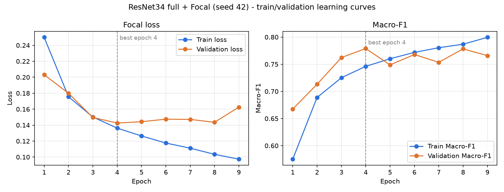

# Faz 4 — Validation Denetimi ve Sonuç Değerlendirmesi

Tarih: 4 Kasım 2026 · Hazırlayan: Bahar (Claude ile), Pınar'ın kararlarıyla · Kapsam: yalnızca train/validation.
**Test verisi açılmadı.** Bu denetimde yeni eğitim yapılmadı, hiperparametre değiştirilmedi, mevcut deney
dosyaları ve checkpoint'ler değiştirilmedi.

**Durum: Faz 4'ün dört deneyi tamamlandı ve denetlendi.** Karşılaştırma çıktıları:
`results/phase4_imbalance_validation.{csv,json}` (üç dengesizlik yöntemi) ve
`results/phase4_validation_summary.{csv,json}` (final CNN ve ResNet34).

## 1. Deneylerin denetimi

### 1.1. Bahar'ın bilgisayarındaki iki deney (tam denetim)

Kontrol aracı: `python -m src.evaluation.audit_run --experiment <ad> --output results/phase4_audit/audit_<ad>.json` (salt okuma; çıktılar `results/phase4_audit/audit_*.json`).

| Kontrol | Weighted Sampler (`phase4_cnn_sampler_ce_seed42_w4`) | ResNet34 (`phase4_final_resnet34_focal_seed42_w4`) |
|---|---|---|
| `best.pth`, `last.pth`, `config.json`, `metrics.json`, `history.csv`, `status.json` | ✅ hepsi var | ✅ hepsi var |
| TensorBoard event dosyası (`runs/`) | ✅ 1 | ✅ 1 |
| `status = completed`, `smoke = false`, `evaluation_split = val` | ✅ | ✅ |
| Manifest SHA-256 dosyayla eşleşiyor (`383da7b8…1ec`) | ✅ | ✅ |
| Sınıf sırası `LABEL_MAP` ile aynı (0 no, 1 minor, 2 major, 3 destroyed) | ✅ | ✅ |
| `history.csv` satır sayısı = tamamlanan epoch | ✅ 17 | ✅ 9 |
| History'deki en iyi epoch/F1 = `metrics.json` | ✅ epoch 12 | ✅ epoch 4 |
| Early stopping tutarlı (en iyiden sonra 5 epoch iyileşme yok) | ✅ | ✅ |
| `best.pth` epoch ve config'i `config.json` ile birebir aynı | ✅ | ✅ |
| `last.pth` son epoch, `finished`, optimizer + RNG + early-stopping durumu içeriyor | ✅ | ✅ |
| `last.pth` içindeki en iyi model ağırlıkları = `best.pth` | ✅ | ✅ |
| Validation örnek sayısı 25.615, yalnızca `split == val` | ✅ | ✅ |
| `best.pth` validation'da yeniden değerlendirildi; Macro-F1 kayıtla aynı | ✅ fark 0,0 | ✅ fark 0,0 |

**Eksik dosya yok.** Yedek: iki deney klasörü, TensorBoard kayıtları ve bu denetim dosyaları GitHub dışında
`C:\Users\bhrto\faz4_yedek_20261104` klasörüne kopyalandı (736 MB, 16 sonuç dosyası; SHA-256 listesi
`yedek_sha256.txt`, kaynakla birebir eşleşiyor). Kayıtlı sürümler: Python 3.13.16, PyTorch 2.14.1+cu132, timm 1.0.30, RTX 4050 Laptop.

### 1.2. Pınar'ın bilgisayarındaki iki deney (metadata denetimi)

Pınar `config.json`, `metrics.json`, `history.csv` ve `status.json` dosyalarını gönderdi
(`Pinar_Faz4_Sonuclari.zip`, SHA-256 `21e0d3b3…772c`). Dosyalar değiştirilmeden
`results/phase4_cnn_focal_seed42_retry_20261018/` ve `results/phase4_cnn_weighted_ce_seed42/` altına kopyalandı.
Denetim: `python -m src.evaluation.audit_run --metadata-only --manifest <yerel patches.csv> ...`.

| Kontrol | Focal (`phase4_cnn_focal_seed42_retry_20261018`) | Weighted CE (`phase4_cnn_weighted_ce_seed42`) |
|---|---|---|
| Dört metadata dosyası | ✅ | ✅ |
| `status = completed`, `smoke = false`, `evaluation_split = val` | ✅ | ✅ |
| Manifest SHA-256 (`383da7b8…1ec`) yerel manifestle eşleşiyor | ✅ | ✅ |
| Val sayısı (25.615) ve train sınıf sayıları manifestle eşleşiyor | ✅ | ✅ |
| Sınıf sırası `LABEL_MAP` ile aynı | ✅ | ✅ |
| History satırı = tamamlanan epoch | ✅ 19 | ✅ 15 |
| History'deki en iyi epoch/F1 = `metrics.json` | ✅ epoch 14 | ✅ epoch 10 |
| Early stopping tutarlı | ✅ | ✅ |
| Checkpoint bütünlüğü ve `best.pth` yeniden değerlendirmesi | ⚪ yapılmadı (checkpoint paylaşılmadı) | ⚪ yapılmadı |

Bu iki koşu daha eski bir config şemasıyla kaydedilmiştir (`training_mode`, `trainable_parameter_count` alanları
yok). Karşılaştırma için gereken tüm alanlar mevcuttur. Sürümler: Python 3.13.7, PyTorch 2.14.1+cu132, timm 1.0.30.

## 2. Karşılaştırılabilirlik

Dört koşuda da aynı olanlar: manifest SHA-256, train/val sayıları (134.028 / 25.615), train sınıf sayıları, seed 42,
128×128 giriş, ImageNet normalizasyonu, train augmentasyonu (flip 0,5/0,5, ±15°), validation'da augmentasyon yok,
AdamW 3e-4 / 1e-4, Cosine (T_max 30, eta_min 1e-6), patience 5, AMP, batch 32. Metrik her koşuda aynı fonksiyonla
(`src/training/metrics.py`, sklearn, `labels=[0,1,2,3]`, `zero_division=0`, macro = 4 sınıf F1 ortalaması)
hesaplanmaktadır. Model seçimi her koşuda en yüksek validation Macro-F1'e göre yapılmıştır.

**Bilinen ve kabul edilen farklar:**

1. **`num_workers`: Weighted Sampler ve ResNet34 koşuları 4, Focal ve Weighted CE koşuları 2 worker ile yapıldı.**
   Ekip kararı: bu fark deneyleri tek başına geçersiz kılmaz. Model, kayıp, veri, split ve metrik aynıdır. Ancak
   veri yükleme sırası ve worker'lara dağılan augmentasyon rastgele sayıları farklı olabilir. Bu nedenle
   `src/training/compare.py` yalnızca `num_workers` farkına izin verecek şekilde güncellendi (`ALLOWED_DIFFERENCES`).
   Diğer bütün politika alanları hâlâ birebir aynı olmak zorundadır. Worker değerleri karşılaştırma CSV'sine
   (`num_workers` sütunu) ve JSON özetine (`allowed_policy_differences`) yazılır. Bu davranış testlerle korunur.
2. Farklı bilgisayar ve Python yaması (3.13.7 / 3.13.16). Seed aynı olsa da GPU sonuçları bit düzeyinde aynı
   değildir. Bu durum Faz 4 planında zaten kabul edilmiştir.
3. Eğitim süreleri farklı bilgisayar ve worker sayılarında ölçülmüştür. **Hız karşılaştırması olarak kullanılmamalıdır.**

## 3. Faz 4 sonuç tablosu (validation, best epoch)

Tüm değerler `metrics.json` dosyalarından alınmıştır. Hiçbir değer tahmin edilmemiştir.

| Model | Dengesizlik | Macro-F1 | No | Minor | Major | Destroyed | Acc. | Best ep. / toplam | Workers | Süre |
|---|---|---:|---:|---:|---:|---:|---:|---|---:|---:|
| **ResNet34 full (ImageNet)** | Focal (γ=2) | **0,7789** | 0,942 | 0,629 | 0,670 | 0,874 | 0,881 | 4 / 9 | 4 | 50 dk |
| Simple CNN | Focal (γ=2) | 0,7411 | 0,924 | 0,559 | 0,632 | 0,849 | 0,850 | 14 / 19 | 2 | 3 sa 4 dk |
| Simple CNN | Weighted Sampler + CE | 0,7179 | 0,888 | 0,562 | 0,623 | 0,799 | 0,805 | 12 / 17 | 4 | 74 dk |
| Simple CNN | Weighted CE | 0,6977 | 0,882 | 0,534 | 0,590 | 0,784 | 0,793 | 10 / 15 | 2 | 1 sa 58 dk |

**Seçimler (deney planındaki kurala göre, yalnızca validation Macro-F1):**
- Dengesizlik yöntemi: **Focal Loss** (`results/phase4_imbalance_validation.json`).
- Model karşılaştırması (aynı Focal stratejisiyle): **ResNet34 full** (`results/phase4_validation_summary.json`).

**Sağlamlık kontrolü:** Focal'ın en iyi değeri (epoch 14: 0,741) tek epoch'luk bir tepedir. Komşu epoch'lar 0,716
ve 0,689'dur. Bu nedenle sıralamayı epoch seçiminden bağımsız bir ölçüyle de kontrol ettik: son 5 epoch'un
ortalama validation Macro-F1 değeri Focal 0,714, Weighted Sampler 0,694, Weighted CE 0,681'dir. Yani sıralama
değişmemektedir. Ardışık epoch'lar arasındaki ortalama validation F1 değişimi Focal 0,025, Weighted Sampler 0,016,
Weighted CE 0,017, ResNet34 0,027'dir.

### Precision / recall (checkpoint'i denetlenen koşular)

| Model | Minor P / R | Major P / R | Destroyed P / R |
|---|---|---|---|
| ResNet34 + Focal | 0,695 / 0,575 | 0,686 / 0,654 | 0,873 / 0,875 |
| CNN + Weighted Sampler | 0,442 / 0,769 | 0,637 / 0,610 | 0,727 / 0,887 |

Confusion matrix'ler `results/phase4_audit/` altındaki JSON dosyalarındadır (satır = gerçek, sütun = tahmin).
Dikkat çekici gözlem: Weighted Sampler minor sınıfını sık tahmin ediyor (recall yüksek, precision düşük; 2.099
hasarsız bina minor olarak tahmin edilmiş). ResNet34 ise tersine minor binaların %29'unu (843 / 2.916) hasarsız
olarak tahmin ediyor. En zor ayrım her iki modelde de **no-damage ↔ minor-damage** arasında. Pınar'ın iki
koşusu için checkpoint paylaşılmadığından precision/recall ve confusion matrix hesaplanmamıştır.

## 4. ResNet34 epoch analizi — overfitting değerlendirmesi

| Epoch | Train loss | Val loss | Train F1 | Val F1 |
|---:|---:|---:|---:|---:|
| 1 | 0,2500 | 0,2031 | 0,575 | 0,667 |
| 2 | 0,1756 | 0,1799 | 0,689 | 0,713 |
| 3 | 0,1502 | 0,1496 | 0,725 | 0,762 |
| **4** | 0,1363 | **0,1426** | 0,746 | **0,779** |
| 5 | 0,1264 | 0,1443 | 0,760 | 0,749 |
| 6 | 0,1176 | 0,1475 | 0,772 | 0,768 |
| 7 | 0,1111 | 0,1472 | 0,780 | 0,754 |
| 8 | 0,1035 | 0,1435 | 0,787 | 0,778 |
| 9 | 0,0974 | 0,1625 | 0,800 | 0,766 |

**Kanıtlar (overfitting yönünde):**
- Train loss epoch 4'ten 9'a sürekli düşüyor (0,136 → 0,097; yaklaşık %29).
- Validation loss en düşük değerine epoch 4'te ulaşıyor (0,1426), sonra bir daha bu seviyeye inmiyor; epoch 9'da en yüksek değere çıkıyor (0,1625; yaklaşık +%14).
- Train Macro-F1 artmaya devam ederken (0,746 → 0,800) validation Macro-F1 0,749–0,778 bandında yatay kalıyor.

**Sınırlamalar (yorumu yumuşatan):**
- Validation Macro-F1 epoch 8'de 0,7783 ile neredeyse en iyi değere geri dönüyor; yani belirgin bir çöküş değil, **plato + dalgalanma** var.
- Ardışık epoch'lar arasındaki ortalama validation F1 değişimi 0,027; tek bir epoch'un en iyi seçilmesi bu dalgalanmadan kısmen etkilenir.
- Train metrikleri augmentasyonlu veride ve eğitim sırasında hesaplanıyor; train/val açığı yalnızca **eğilim** olarak yorumlanmalı (ilk epoch'larda train F1'in val'den düşük olması bundandır).

**Sonuç:** Epoch 4–5'ten sonra **hafif overfitting** başladığına dair tutarlı kanıt vardır. Early stopping ve
`best.pth` seçimi bunu doğru biçimde yönetmiştir; raporlanan model epoch 4 modelidir. Tüm katmanların hazır
ağırlıklarla 3e-4 öğrenme oranında eğitilmesi olası bir katkı faktörüdür, ancak bu bir **hipotezdir**, test
edilmemiştir. **Ekip kararı:** Faz 4 kapsamında yeni bir ResNet34 eğitimi yapılmayacak. Raporlanan model,
early stopping ile seçilen epoch 4 modelidir. Eğitim, en iyi epoch'tan sonra patience 5 boyunca iyileşme olmadığı
için epoch 9'da durdurulmuştur.

## 5. Final CNN kararı

**Ekip kararı: Mevcut Simple CNN + Focal koşusu (`phase4_cnn_focal_seed42_retry_20261018`) final CNN olarak
kullanılmıştır. Ayrı bir final CNN eğitimi yapılmamıştır.** Bu, deney planındaki "seçilen yöntemle ayrı final CNN
koşusu" adımından bilinçli bir sapmadır.

Gerekçe:
1. Planlanan "final CNN" koşusu, seçilen yöntemle (Simple CNN + Focal, sampler yok, seed 42, aynı veri ve ayarlar)
   **aynı yapılandırmanın** tekrarıdır. Aynı seed ve ayarlarla yeniden eğitmek yeni bilgi üretmez; yalnızca GPU
   kaynaklı küçük sayısal farklar oluşturur.
2. Seçim yalnızca validation Macro-F1 ile yapıldı ve test kullanılmadı. Bu yüzden mevcut koşuyu final olarak
   kullanmak test sızıntısı yaratmaz.
3. Yeniden eğitim, aynı validation setinde ikinci bir "şans" denemesi anlamına gelir; bu, seçim yanlılığını azaltmaz.

Doğrulanan koşullar:
- ✅ `status = completed`, `smoke = false`, manifest SHA-256 `383da7b8…1ec`, val sayısı 25.615 (bölüm 1.2).
- ✅ Config, ResNet34 koşusuyla aynı politikaya sahip (aynı loss/sampler, optimizer, scheduler, augmentasyon).
  `compare.py --kind models` bu iki koşuyu yalnızca `num_workers` farkıyla kabul etti.
- ⚪ `best.pth` yeniden değerlendirmesi yapılmadı, çünkü checkpoint paylaşılmadı. Pınar'ın elindeki `best.pth`
  ile `python -m src.evaluation.audit_run --experiment phase4_cnn_focal_seed42_retry_20261018 --output ...`
  komutu çalıştırılırsa bu kontrol de tamamlanır. Faz 6'daki test değerlendirmesi için `best.pth` zaten gereklidir.

Raporlanması gereken sınırlama: Üç dengesizlik yöntemi arasındaki farklar (0,698 / 0,718 / 0,741) tek seed ile
ölçülmüştür ve en iyi Focal değeri tek epoch'luk bir tepedir. Son 5 epoch ortalamasında da sıralama korunmaktadır
(bölüm 3). Yine de Focal'ın üstünlüğü **"bu deney koşullarında gözlenen"** olarak ifade edilmelidir. İstatistiksel
kesinlik için çoklu seed gerekir (Faz 4 kapsamı dışında, isteğe bağlı).

## 6. Kısa akademik değerlendirme

Validation setinde (25.615 bina, 4 sınıf) ImageNet ön eğitimli ResNet34 early-fusion modeli, Focal Loss ile
**0,779 Macro-F1** elde ederek en iyi sonucu vermiştir. Bu değer aynı kayıp fonksiyonunu kullanan Simple CNN'e göre
yaklaşık 0,038 daha yüksektir. Ön eğitimli, daha yüksek kapasiteli bir modelin yaklaşık 225 kat daha fazla
parametreyle (21,3 M'ye karşı 94,9 K) daha iyi sonuç vermesi beklenen bir bulgudur. Model en iyi sonucuna 4.
epoch'ta ulaşmış, sonrasında hafif overfitting gözlenmiş ve early stopping bunu sınırlamıştır.

Sınıf dengesizliği için Simple CNN üzerinde karşılaştırılan üç yöntem arasında Focal Loss (0,741) en yüksek
Macro-F1'i vermiş, onu Weighted Sampler (0,718) ve Weighted CE (0,698) izlemiştir. Focal Loss en yüksek değeri
dört sınıfın üçünde vermiştir (no-damage 0,924, major 0,632, destroyed 0,849). Minor-damage sınıfında ise Weighted
Sampler (0,562) ve Focal (0,559) birbirine çok yakındır. Tüm modellerde en zor sınıflar
minor-damage ve major-damage'dir. Hatalar ağırlıklı olarak komşu hasar seviyeleri arasında, özellikle no-damage ile
minor-damage arasında yoğunlaşmaktadır. Destroyed sınıfı görsel olarak daha belirgin olduğundan yüksek F1 ile
ayrılabilmektedir.

Tüm skorlar model seçiminde de kullanılan validation setine aittir ve bu nedenle iyimser olabilir. Tarafsız
performans tahmini Faz 6'da, test seti üzerinde **tek seferlik** değerlendirmeyle elde edilecektir.
